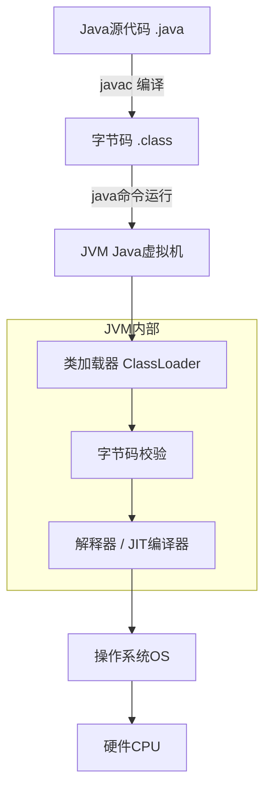
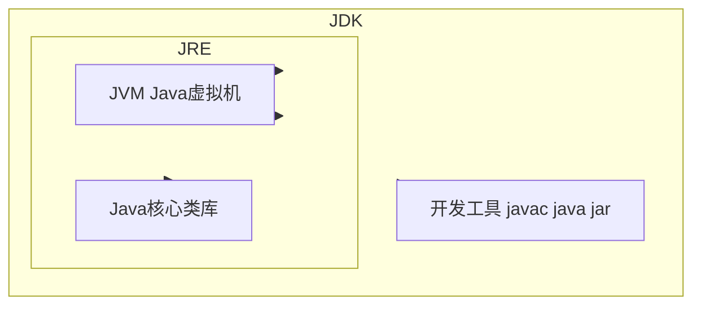
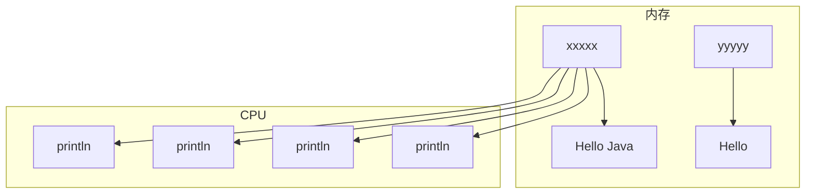
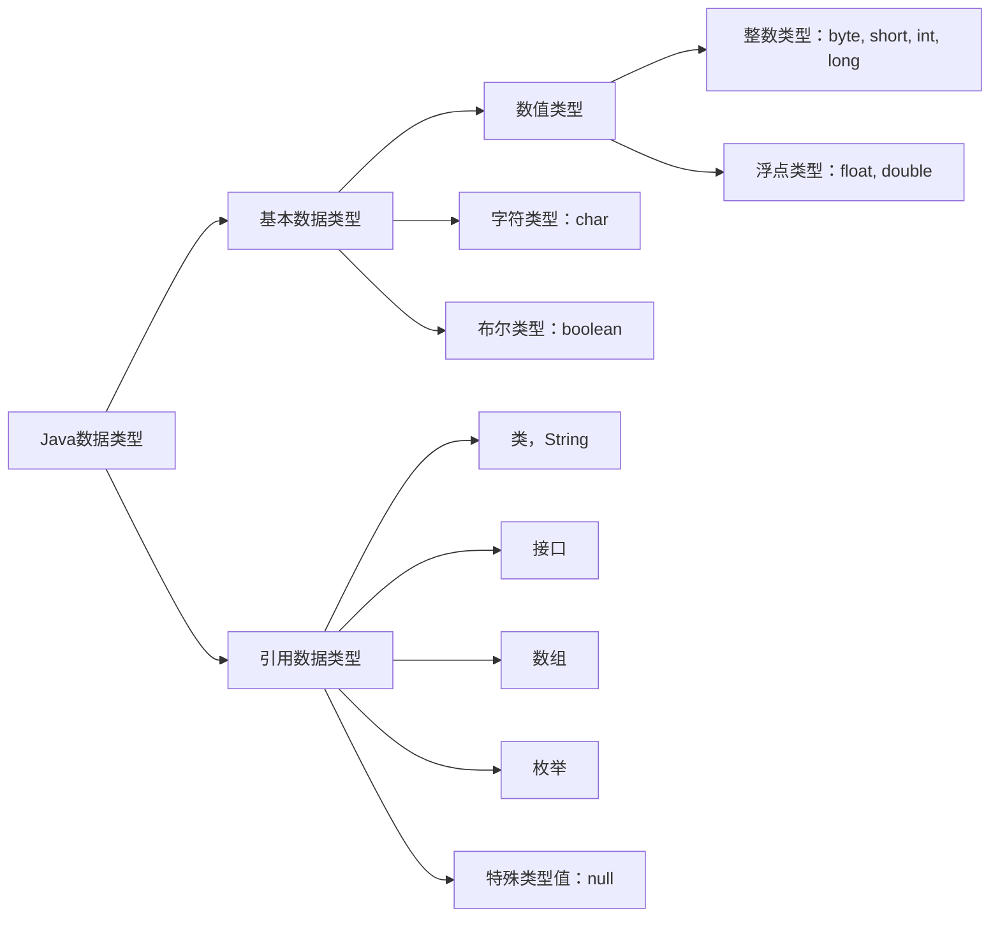
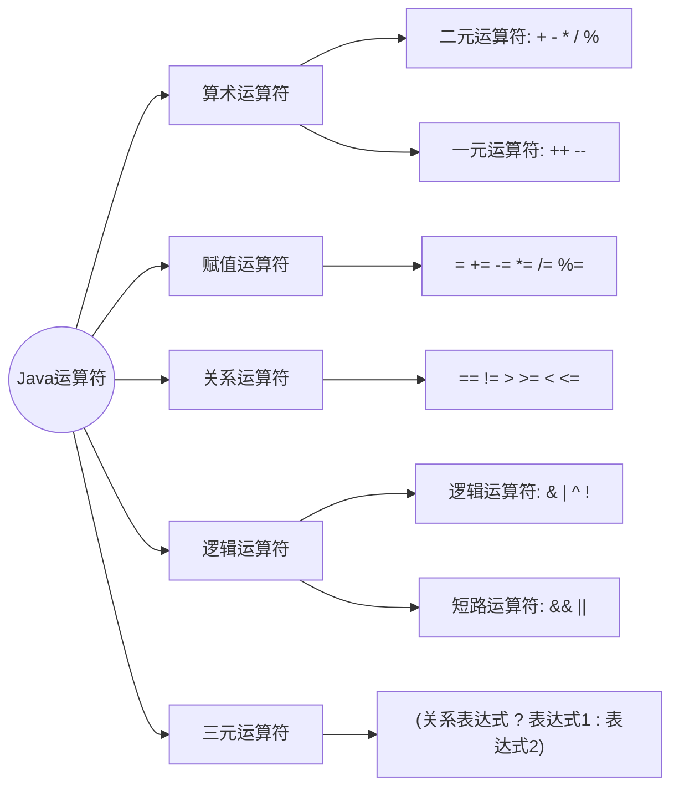

# Java 基础核心笔记

## 一、 基础概念与运行机制

### 1.1 JDK、JRE、JVM 的关系
**JDK > JRE > JVM**



*   **JDK（Java Development Kit）**：Java 开发工具包 = JRE + 开发工具集（javac、java、jdb 等）。给**开发者**用，用于开发 + 运行 Java 程序。安装 JDK 时会自带一份 JRE。
*   **JRE（Java Runtime Environment）**：Java 运行时环境 = JVM + Java 核心类库。给**普通用户**用，只运行 Java 程序，不含编译工具（无 javac）。不能编写代码或编译源码。
*   **JVM（Java Virtual Machine）**：Java 虚拟机，JRE 里面最核心的部分，只负责执行 `.class` 字节码文件。不同操作系统有不同版本 JVM，实现 Java“一次编译，到处运行”。

> **极简记忆**：
> * 开发程序 → 需要 **JDK**（里面自带 JRE 和 JVM）
> * 只跑程序 → 只装 **JRE**（里面自带 JVM）
> * 真正执行字节码的 → **JVM**

**JDK、JRE、JVM 包含关系图：**


### 1.2 注释与第一个 Java 程序
```java
package Chapeter01;

public class java01_HelloWorld {
    public static void main(String[] args) {
        System.out.println("Hello World");
        
        // 单行注释
        
        /*
          TODO 标记功能（不是java语法）
          多行注释
          多行注释
        */
    }
}
```

**IDEA 常用快捷键**：
* `Ctrl + D`：复制当前行
* `Ctrl + R`：替换当前文字

---

## 二、 变量与标识符

### 2.1 变量核心概念
1. **内存**：存放数据的地方。
   * 数据存储区：保存真实数据，比如字符串 `Hello Java`。
   * 变量（向量存储）：变量里面**不存真实数据**，存的是**数据的地址**（编号 xxxxx / yyyyy）。
2. **变量**：可以理解成“地址标签”，通过地址找到内存里真正的数据。
3. **CPU**：负责执行代码（如 `println()`）。CPU 读取变量里保存的地址，根据地址去内存取出数据，完成运算/打印。

> **一句话总结**：变量存地址，内存存真实数据；CPU 通过变量保存的地址，去内存读取数据。



**Java 变量使用示例：**
```java
package Chapter02;

public class java01_Variable {
    public static void main(String[] args) {
        // TODO 变量
        // 所谓的变量，其实就是可以改变的向量存储
        
        // 1. 变量的声明
        String name;
        // 2. 变量的赋值
        name = "张三";
        // 3. 变量的使用
        System.out.println(name);
        
        // 将变量的声明和赋值在一行代码中完成
        String username = "李四";
        System.out.println(username);
    }
}
```

### 2.2 标识符命名规范
标识符即起名字（变量名、类名等），命名规则如下：

1. **英文拉丁字母**：如 `String username = "zhangsan";`
2. **符号**：只能采用下划线和美元 `$` 符号，如 `String _name = "wangwu";`，`String $name = "wangwu";`
3. **数字**：数字不能位于开头位置。
4. **唯一性**：在大括号范围内，标识符不能重复；严格区分大小写。
5. **关键字/保留字**：Java 语言中预先定义好了一些标识符名称（如 `public`），不能作为变量名。
6. **驼峰规范**：首字母小写，后续单词首字母大写（如 `userName`）。

```java
package Chapter02;

public class java02_Indentifer {
    public static void main(String[] args) {
        // 标识符命名示例
        String username = "zhangsan";
        String xingming = "lisi";
        
        // 符号测试
        String _name = "wangwu";
        String $name = "wangwu";
        String $na_me = "wangwu";
        System.out.println(_name);
        System.out.println($name);
        System.out.println($na_me);
        
        String Name = "GOUD";  // 区分大小写
        String userName = "lisi"; // 驼峰标识规范
    }
}
```

---

## 三、 数据类型与转换

### 3.1 数据类型分类


**基本数据类型示例代码：**
```java
package Chapter02;

public class java03_Datetype01 {
    public static void main(String[] args) {
        // TODO 整数类型
        // byte：8bit; short:16bit; int:32bit; long:64bit
        
        // TODO 浮点类型
        // 根据计算精度分为：
        // float：单精度，数据需要使用F（f）结尾
        float f = 1.0f;
        // double：双精度
        double d = 2.0;
        
        // TODO 字符类型
        char c = '&';  // 单引号
        
        // TODO 布尔类型
        boolean bln = true;
    }
}
```

### 3.2 数据类型转换
Java 中范围小的数据可以直接转换范围大的数据（自动类型提升），但是范围大的数据无法直接转换范围小的数据（需要强制转换）。

**转换顺序**：`byte --> short --> int --> long --> float --> double`

```java
package Chapter02;

public class java03_Datetype02 {
    public static void main(String[] args) {
        // 自动类型提升
        byte b = 10;
        short s = b;
        int i = s;
        long lon = i;
        float f = lon;
        double d = f;
        
        // 强制类型转换：将范围大的数据转换为范围小的数据，需要使用小括号
        int i1 = (int) d;
    }
}
```

---

## 四、 运算符详解



### 4.1 算术运算符
> **概念**：所谓运算符就是参与数据运算的符号。表达式 = 元素1 + 运算符 + 元素2。
> 表达式的结果类型是元素中类型最大的那一种。

**二元运算符**：`+`、`-`、`*`、`/`、`%`
**一元运算符**：`++`、`--`

```java
package Chapter02;

public class java04_Operator {
    public static void main(String[] args) {
        // TODO 算术运算符 - 二元
        System.out.println(1 + 2); // 3
        System.out.println(2 - 2); // 0
        System.out.println(3 * 2); // 6
        System.out.println(4 / 2); // 2
        System.out.println(1 / 2); // 0 (int, int) => int
        System.out.println(1.0 / 2); // 0.5 (double, int) => double
        System.out.println(5 % 2); // 1 (取余, 模运算)

        byte b1 = 10;
        byte b2 = 20;
        byte b3 = (byte)(b1 + b2); // (int, int) => int (需要强制转换)

        System.out.println( 1 + 2 * 3 ); // 7 (乘法优先级高于加法)
        System.out.println( (1 + 2) * 3 ); // 9 (括号优先级最高)

        // TODO 算术运算符 - 一元 (++, --)
        // 前置递增/递减：先运算，后赋值
        int i = 1;
        int j = --i; // i先减1变成0，再赋值给j
        System.out.println("i = " + i); // 0
        System.out.println("j = " + j); // 0

        // 后置递增/递减：先赋值，后运算 (展开代码逻辑)
        int i2 = 0;
        int j2 = i2++; // 等价于：j2 = i2; i2 = i2 + 1;
        System.out.println("i2 = " + i2); // 1
        System.out.println("j2 = " + j2); // 0
    }
}
```

### 4.2 赋值运算符
* 基础赋值：`=`（将等号右边表达式的结果赋值给等号左边的变量，需要考虑类型关系）。
* 复合赋值：`+=`、`-=`、`*=`、`/=`、`%=`。
* **核心特性**：如果使用了复合赋值运算符，那么数据的类型不会发生变化（隐含了强制类型转换）。

```java
package Chapter02;

public class java04_Operator01 {
    public static void main(String[] args) {
        int i = 1;
        i *= 2; // 等价于 i = i * 2;
        System.out.println(i); // 2

        byte b1 = 10;
        // b1 = b1 + 20; // 报错：int 不能直接赋值给 byte
        b1 += 20; // 不报错，等价于 b1 = (byte)(b1 + 20);
        System.out.println(b1); // 30
    }
}
```

### 4.3 关系运算符
关系运算符用于比较两个数据之间的关系，**结果一定是布尔类型（`true` 或 `false`）**。
包含：`==`（相等）、`!=`（不相等）、`>`、`>=`、`<`、`<=`。

```java
package Chapter02;

public class java04_Operator02 {
    public static void main(String[] args) {
        int i = 10;
        int j = 20;
        System.out.println( i == j ); // false
        System.out.println( i != j ); // true
        System.out.println( i > j );  // false
        System.out.println( i >= j ); // false
        System.out.println( i < j );  // true
        System.out.println( i <= j ); // true
    }
}
```

### 4.4 逻辑运算符
用于描述多个条件表达式之间的关系，结果依然是布尔类型。

* **`&` (与运算)**：两个条件都必须计算，只有都是 `true`，结果才为 `true`。
* **`|` (或运算)**：两个条件都必须计算，只要有一个 `true`，结果就是 `true`。
* **`&&` (短路与)**：如果第一个条件为 `false`，则**不再执行**第二个条件（短路）。
* **`||` (短路或)**：如果第一个条件为 `true`，则**不再执行**第二个条件（短路）。
* **`!` (非运算)**：取反，`true` 变 `false`，`false` 变 `true`。

```java
package Chapter02;

public class java04_Operator03 {
    public static void main(String[] args) {
        // 1. 逻辑与 & 
        int i = 10;
        boolean result1 = (i > 5) & (i < 20); // true & true = true
        System.out.println(result1);

        // 2. 短路与 && (常用)
        int j = 20;
        boolean result2 = (i > 10) && (++j > 30); // 左侧false，右侧不执行
        System.out.println(result2); // false
        System.out.println(j);       // 20 (j未自增)

        // 3. 短路或 || (常用)
        int k = 20;
        boolean result3 = (i == 10) || (++k > 30); // 左侧true，右侧不执行
        System.out.println(result3); // true
        System.out.println(k);       // 20 (k未自增)

        // 4. 逻辑非 !
        boolean result4 = i == 10;
        boolean result5 = i > 10;
        System.out.println(!result4); // false
        System.out.println(!result5); // true
    }
}
```

### 4.5 三元运算符
* **语法**：`变量 = (条件表达式) ? (表达式1) : (表达式2);`
* **运算规则**：条件表达式为 `true`，执行表达式1；为 `false`，执行表达式2。

```java
package Chapter02;

public class java04_Operator04 {
    public static void main(String[] args) {
        int i = 15;
        int j = 20;

        // i == 10 为 false，因此执行冒号后面的表达式 2 + 2
        int k = ( i == 10 ) ? 1 + 1 : 2 + 2;
        System.out.println(k); // 4
    }
}
```

未完待续...